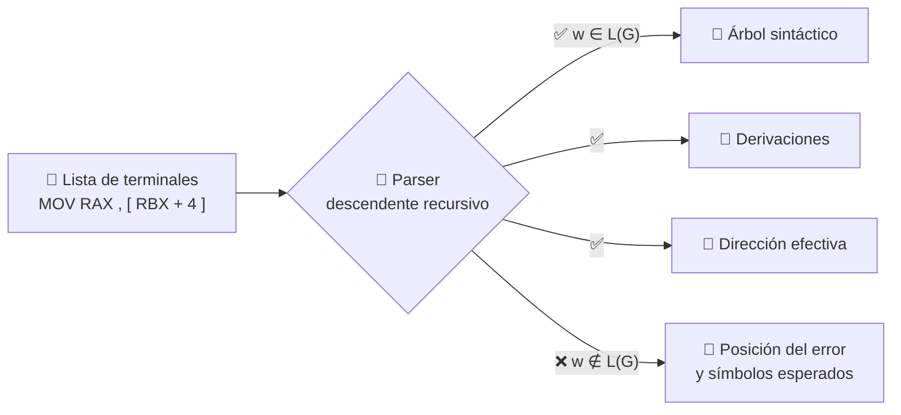

<div align="center">

# 🧠 Analizador Sintáctico x86/x64

### *Donde el ensamblador se encuentra con la teoría de lenguajes formales*

<br>


-BB9AF7?style=flat-square)


<br>

> **Escribe una instrucción en ensamblador y míralo pensar.**
> El programa decide si tu código pertenece al lenguaje, construye su árbol sintáctico
> y, si te equivocas, te dice exactamente dónde y qué esperaba.

</div>

---

## ✨ ¿Qué hace?

<table>
<tr>
<td width="50%" valign="top">

### 🌳 Construye el árbol sintáctico
Cada instrucción válida se convierte en un árbol jerárquico, con colores por tipo de símbolo, que puedes recorrer, ampliar y exportar como imagen.

</td>
<td width="50%" valign="top">

### 🎯 Señala el error con precisión
Si la cadena no es válida, el programa indica la **posición exacta**, el símbolo que encontró y los que esperaba. El token culpable se ilumina en rojo.

</td>
</tr>
<tr>
<td width="50%" valign="top">

### 🔁 Muestra las derivaciones
Reconstruye paso a paso la derivación **más a la izquierda** y **más a la derecha**, resaltando en cada paso el símbolo que se expande.

</td>
<td width="50%" valign="top">

### 🧭 Entiende la memoria
Interpreta direcciones como `[ RAX + RBX * 4 + 0x10 ]`, respeta la precedencia de los operadores y resume la dirección efectiva final.

</td>
</tr>
</table>

---

## 🔤 El lenguaje que entiende

<div align="center">

| | Elemento | Ejemplo |
|:---:|:---|:---|
| 🔵 | **Instrucciones** | `MOV` · `ADD` · `CMP` · `JMP` |
| 🟢 | **Registros** | `RAX` `RBX` `RCX` … `R15` · `EAX` … `ESP` |
| 🟠 | **Inmediatos** | `5` · `-1` · `0x10` |
| ⚪ | **Memoria** | `[ base + índice * escala ± desplazamiento ]` |
| 🟣 | **Etiquetas** | `inicio :` · `JMP inicio` |

</div>

Y además conoce las reglas reales del procesador:

- 🚫 Nunca dos operandos de memoria en la misma instrucción
- 🚫 Un número nunca puede ser el destino
- ✅ Solo escalas de **1, 2, 4 u 8**
- 🚫 `RSP` nunca puede usarse como índice

---

## 🔍 Así piensa el analizador



Sin analizador léxico: el programa recibe directamente los símbolos y cada **no terminal** de la gramática es una función que decide qué camino tomar mirando un solo símbolo hacia adelante.

---

## 🌳 Un vistazo al árbol

<div align="center">

`inicio : MOV RAX , [ RBX + RCX * 4 + 0x10 ] JMP inicio`

</div>

```text
PROG
├── SENT ── inicio :
└── RESTO
    ├── SENT
    │   └── INSTR
    │       ├── MOV
    │       └── OPS
    │           ├── RAX
    │           ├── ,
    │           └── MEM
    │               ├── [
    │               ├── RBX + RCX * 4 + 0x10
    │               └── ]
    └── RESTO
        └── JMP inicio
```

<sub>*Versión resumida. En el programa el árbol se dibuja completo, con colores y nodo por nodo.*</sub>

---

## 🎯 Cuando algo sale mal

<div align="center">

`MOV [ RAX ] , [ RBX ]`

</div>

> ❌ **Error sintáctico en la posición 6 (en FMEM):** se encontró `'['` pero se esperaba un registro, un número o `'-'`.

El procesador no permite mover de memoria a memoria, y la gramática tampoco.

---

## 🎨 Diseñado con las leyes de la Gestalt

<div align="center">

| Ley | Cómo se siente en la interfaz |
|:---|:---|
| 🧲 **Proximidad** | Todo lo de entrada a la izquierda, todos los resultados a la derecha |
| 🎨 **Semejanza** | Cada tipo de símbolo tiene su color, igual en chips, árbol y leyenda |
| 🗂️ **Región común** | Cada bloque vive en su propia tarjeta |
| 🌗 **Figura-fondo** | Fondo sereno; el resultado y el error resaltan |
| ➡️ **Continuidad** | La mirada fluye de la entrada al resultado y del nodo raíz a las hojas |
| 🔗 **Conectividad** | Las líneas unen cada nodo con sus hijos |
| 🎯 **Destino común** | Al pasar el mouse por un nodo se ilumina todo su subárbol |
| ✨ **Pregnancia** | Una sola acción principal: **Analizar** |

</div>

---

## 📐 Bajo el capó, en números

<div align="center">

| 19 | 41 | 62 | 0 |
|:---:|:---:|:---:|:---:|
| **no terminales** | **terminales** | **producciones** | **ambigüedades** |

</div>

La gramática partió de una versión ambigua donde `[ RBP - 8 + 4 ]` podía leerse de dos formas (y apuntar a dos celdas distintas de memoria). Se transformó en una gramática **LL(1)** equivalente, en la que cada cadena tiene un único árbol.

---

<div align="center">

## 👥 Equipo

| | Integrante |
|:---:|:---|
| 👨‍💻 | **Juan Esteban Maya Sánchez** |
| 👨‍💻 | **Juan Pablo López Gómez** |

<br>

**Teoría de Lenguajes Formales**
Ingeniería de Sistemas y Computación
Universidad del Quindío · 2026-2

<br>

<sub>Hecho con 🧠, gramáticas y muchos árboles 🌳</sub>

</div>